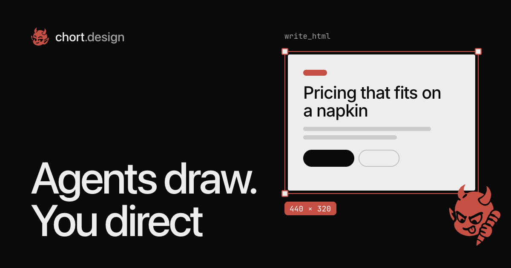

<h1 align="center">chort</h1>

<strong>Design canvas for coding agents — real HTML and CSS over MCP</strong>

<a href="https://chort.design">Website</a> · <a href="https://youtu.be/du8EQkYv-Ek">Watch 47s demo</a> · <a href="https://github.com/deeflect/chort/releases/latest">Download Beta (macOS Apple silicon)</a> · <a href="https://github.com/deeflect/chort/issues/new">Report a bug</a>

  

chort is a local design canvas for coding agents. Claude Code, Codex and any MCP agent draw boards in real HTML and CSS laid out by a real browser engine, while you direct, comment on the canvas, and export clean JSX/Tailwind.

> **Beta & Open Source:** chort is **free during beta** with no account or call limits. Source code is being prepared and will be published right here in this repository under **AGPL-3.0** soon.

## Download

Grab the latest signed & notarized macOS beta installer from **[GitHub Releases](https://github.com/deeflect/chort/releases/latest)**:

- **macOS (Apple silicon):** `chort-0.1.6-mac-arm64.dmg`

Automatic updates are built in and pull directly from this repository's GitHub Releases (`chort → Check for Updates…`).

## Features

- **Real HTML & CSS:** Agents write boards with `write_html` and edit styles with `update_styles`—no custom vector format translation.
- **Local files, Git history:** Boards live in `~/Documents/chort` on your disk. No hosted server, no account, no cloud sync.
- **Canvas comments:** Comment directly on frames; agents read the threads, apply fixes, and resolve them.
- **Automated design checks:** `check_design` reports overflow, low contrast, misalignment and tiny text as text so agents need fewer screenshots.
- **Components & Tailwind v4 tokens:** Main components + instances, CSS custom property design tokens, atomic undo per agent turn, and checkpoints.
- **Clean code & export:** `get_jsx` returns JSX with Tailwind classes or inline styles; export PNG, JPG, WebP, AVIF, SVG, PDF and handoff bundles.
- **Self-contained Mac app:** Bundles its own headless browser and runtime—no Chrome, Node or npm install required.

## Questions

### When is the source code going public?
Soon—this repository will receive the full **AGPL-3.0** source tree once the pre-release cleanup finishes. Until then, signed beta downloads, auto-updates and issue tracking live here.

## Feedback

Bug reports and feature requests are welcome in [Issues](https://github.com/deeflect/chort/issues).

## Made by

chort is made by [Dmitry (Dee) Kargaev](https://www.deeflect.com) (`deeflect`).
